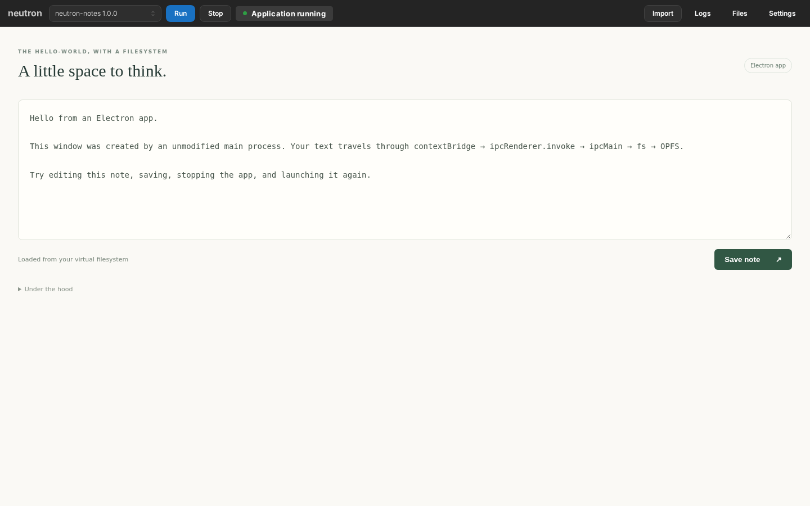

# Neutron

[](https://github.com/hazelcaffe/Neutron/actions/workflows/ci.yml)

Run unmodified Electron apps in the browser. Open an installed app's complete **resources folder**, or a **ZIP of it**. Neutron stores the resources in the browser's private file system (OPFS), runs the app's main process in a Web Worker, and opens its windows in the page. Nothing is uploaded: the app's code and files stay in your browser.



Neutron is a compatibility implementation of Electron and Node.js APIs in JavaScript and WebAssembly, not a port of Electron's Chromium/Node/native binaries. Apps that rely on native `.node` addons for core features don't work fully yet; [docs/compatibility-results.md](docs/compatibility-results.md) records what was verified with real apps.

> **Status:** experimental. Neutron is not affiliated with Electron, the OpenJS Foundation, or the makers of any app mentioned here. Import only apps you are licensed to use; this repository contains no third-party app packages.

## Run

Requires Node.js 24 or newer and pnpm 12 (pinned in `packageManager`).

```sh
pnpm install
pnpm dev
```

Open the Vite URL and use **Open resources folder**, **Open ZIP**, or **Try the example app**, or drop a folder or ZIP onto the page. The **Import** menu at the top offers the same choices. Valid bundles launch automatically. To launch an app again, choose it at the top and press **Run** (pressing Run on an app that is running restarts it). **Stop** asks the app to quit. **Logs** (Ctrl+\`) shows runtime and app output; **Files** downloads files an app saved; **Settings** holds the relay, platform and API options and removes the selected app. The UI follows the system light or dark theme.

The active app fills the viewport without window borders or a host title bar. When an app has more than one window, or its only window is hidden, a tab row appears: click a tab to show that window, middle-click or **×** to close it, and use the arrow keys to move between tabs. Hidden windows are labeled, inactive windows stay loaded, and if every window is hidden (as some apps do while they start) the viewport offers to show one. **Settings → Show application menu bar** shows the app's own menu bar. Top-level window bounds follow the viewport; embedded BrowserViews/WebContentsViews keep their app-defined geometry.

### Project layout

- **`packages/runtime`** (`@neutron/runtime`): the compatibility layer, i.e. the actual project, as a library with no UI. It exposes a `Neutron` class (import, run, stop, windows, menus, logs and files) and a Vite plugin that serves its assets. See [packages/runtime/README.md](packages/runtime/README.md) for the API.
- **`src/`**: the Neutron app, a small React + [Mantine](https://mantine.dev) UI. It imports only `@neutron/runtime`'s public entry point, and Biome's `noRestrictedImports` rule rejects deep imports into the package.

Set **Settings → Platform** to match the imported distribution (Linux, Windows, or macOS). This selects process/OS metadata and default path semantics for the next launch. The filesystem remains browser-backed on every platform.

During `pnpm dev`, open **http://localhost:5173/**. Runtime edits rebuild the generated assets; save your work and reload the page yourself to pick them up. Automatic hot reload is opt-in (`NEUTRON_HMR=1 pnpm dev`). Use the same hostname and port to keep the same browser storage.

**Sign-in links:** `shell.openExternal()` opens HTTP(S) URLs in a **Browser** tab inside Neutron, through Scramjet and Wisp. The tab runs web content without the desktop app's preload, Node globals or Electron user agent. A return navigation to a scheme registered with `app.setAsDefaultProtocolClient` is delivered to the running app (`open-url`, or `second-instance` for a single-instance app without a URL listener). Only the destination origin appears in the Browser tab label. This is a virtual browser handoff, not OS-wide protocol registration. Passkeys remain bound to the real browser origin: a localhost-hosted page cannot use a passkey for a vendor domain.

Apps can also receive an HTTP callback in their main process by binding a virtual `http.createServer()` listener to `127.0.0.1`, `localhost`, or `::1`, including with port `0`. Redirects in the Neutron Browser tab can reach the active listener without binding a socket on the host OS. External providers that require a native system browser, an OS credential helper or popup-opener messaging can still have additional requirements.

Packaged BrowserWindow renderers and their preloads see an Electron-style user agent with the application name/version, virtual OS and Chromium version. App, session, WebContents and navigation overrides are supported. `node:url` file conversions honor the virtual cwd and platform, including Windows drive and UNC paths.

### What to import

Choose the installed app's `resources` directory, including its sibling files:

```text
resources/
├── app.asar                 Electron bootstrap
├── app.asar.unpacked/       Companion files, when present
├── obsidian.asar            Example of a separate application/update archive
└── other resources…
```

Unpacked `resources/app/` packages are supported too. ZIPs may contain the resources contents directly or enclose them in an application/resources directory. Individual ASAR uploads are no longer the import flow: they frequently omit required companion files or the actual bootstrap.

New imports mount resources at `/neutron/resources`, beside the virtual executable, with `/resources` as an alias. Existing installations keep their original layout until reimported. `process.resourcesPath`, `app.getAppPath()`, the main entry point and module-relative paths use the installed layout. Each ASAR is mounted as a directory, its original bytes remain available through `fs.readFile`, and `app.asar.unpacked` entries are connected automatically. `/app` is an alias for the selected application package.

ASAR files may share stored byte ranges. The official Windows Postman package uses these to deduplicate files; Neutron accepts them while validating offsets and lengths against the archive boundary. Postman **12.37.3** has been tested through **Continue without an account → Open Lightweight API Client → Send**, with the response body received from a local HTTP fixture over Wisp. Authenticated workflows and native integrations remain unverified.

The importer validates the package's declared `main`, or the actual default `index.js`. If neither exists, it asks for a main-process file instead of guessing. For example, an `obsidian-dev` update archive with a missing `index.js` is not a runnable launcher by itself. A complete resources import lets Neutron find the separate bootstrap. The official Obsidian **1.15.1 Linux resources** have been tested through vault creation, typing a note, stopping, reloading, and reopening the persisted note. This is not a claim that every feature/plugin or Obsidian release is supported.

### Permissive API behavior

Unsupported APIs use best-effort fallbacks by default, rather than stopping startup:

- Missing Electron members and native addon exports support no-op calls, constructors, events, callbacks, and appropriate empty/default results.
- Missing optional dependencies produce a logged stub. The application's entry point must still exist.
- The virtual Git CLI implements a bounded anonymous smart-HTTP clone and repository-inspection subset through isomorphic-git, OPFS and Wisp. Unsupported Git commands return nonzero status. Other unsupported native process commands may use no-op children with empty output; no executable is launched.
- The updater reports no update available, desktop capture returns no sources, and native UI objects retain basic configuration without creating OS UI.
- Basic `vm` evaluation and structured-value `v8.serialize`/`deserialize` polyfills are provided.
- Each fallback logs a `[compat]` warning once per API. It is a startup compatibility aid, not a native implementation.

Enable **Settings → Throw on unsupported APIs** to get explicit errors instead. This takes effect on the next launch. Actual application exceptions, malformed packages, missing entry files, and real filesystem/network failures remain errors in either mode.

```sh
pnpm build
pnpm preview
```

The output in `dist/` is statically deployable. Use HTTPS or localhost and serve it at the origin root. Serve `/sw.js` as JavaScript and WASM files as `application/wasm`; do not rewrite missing runtime/vendor assets to `index.html`.

On startup, Neutron waits for the updated service worker to control the page and acknowledge its runtime protocol before enabling Run. Pending file writes are acknowledged by that same worker. If the controller changes during a write, Neutron surfaces the error instead of replaying the mutation.

For synchronous renderer IPC, serve these headers:

```http
Cross-Origin-Opener-Policy: same-origin
Cross-Origin-Embedder-Policy: credentialless
```

Vite dev/preview set them, and `public/_headers` supplies the equivalent for hosts supporting that convention. Async IPC works without cross-origin isolation. A current Chromium-based browser is the tested target; OPFS, service workers, SharedWorker, and WebAssembly are required for the complete runtime.

## Networking

**`pnpm dev` and `pnpm preview` provide a Wisp relay automatically at `/wisp/` on the same server.** The UI discovers it, so no URL configuration is needed. Leave **Settings → Wisp relay URL** blank to use it. An explicitly entered URL overrides the local relay; **Disable external networking** opts out.

For a static production deployment, supply your own `wss://…/wisp/` endpoint in Settings. The dev relay is not included in `dist/`. Its WebSocket upgrades are restricted to the dev origin; it permits local/private destinations for development. It carries connections only—uploaded application code and files still execute/stay in the browser.

- HTTP, HTTPS, WebSocket, and TLS connections use **libcurl.js**, with TLS performed in the browser.
- The network transport and raw outgoing TCP/UDP sockets use **wisp-js**.
- Remote BrowserWindows, embedded frames, and remote nested pages use **Scramjet** over its libcurl transport.
- Local renderer `fetch`, WebSocket, and service-worker-intercepted external resources use these transports as well.
- The Wisp relay forwards network connections. It does not receive the ASAR or run application code. An external relay is necessary to reach arbitrary TCP/UDP destinations from a browser.
- Apps needing no external network can run with networking disabled in Settings.

The runtime uses **Scramjet v2 (`2.0.67-alpha.2`)**, the v2 core used by the browser.js project. This is an explicitly pinned upstream alpha release. Its `ScramjetFetchHandler`, HTML/CSS/JavaScript rewriters, `ScramjetClient`, injection hooks, URL codec and worker rewriting handle all browser content—including local files and Electron custom protocols. Neutron's former custom HTML/CSS/browser-import rewriters have been removed. A v2 `ProxyTransport` adapter connects these APIs to **libcurl.js + wisp-js**.

Upstream v2 passes non-HTTP schemes through to native handlers. `scripts/assets.mjs` applies checked, version-pinned integration hooks; the build fails if a target no longer matches upstream:

- The URL branch routes `file:` and Electron schemes through the same Scramjet rewriters.
- Synchronous XHR uses a pre-started transport worker after Scramjet resolves the URL. This avoids Chromium bypassing the service worker during a synchronous request. Reopening the XHR clears the previous reply. This bridge requires cross-origin isolation and has a 64 MiB response limit.
- Worker entry points retain a hierarchical proxy URL so static relative imports and dynamic imports can link in module workers.
- A hook runs before the JavaScript rewriter. Upstream deletes `debugger` statements, which leaves invalid code after `if (x) debugger` (common in minified bundles, including Signal's). `src/shared/scramjet-debugger.ts` first replaces each such statement with a no-op of the same length, so the output stays valid and source maps keep their offsets.
- Fragment-only references (`href="#"`, `#section`) stay relative, and empty fragments are preserved. Upstream made them absolute and dropped an empty `#`, so a `href="#"` link (as on Figma's sign-in page) reloaded the page instead of navigating within it.
- For documents without a conventional `<html><head>`, upstream injects its scripts before `<!DOCTYPE html>`, which switches the page to quirks mode (Google's sign-in pages then lay out wrongly). They are injected after the doctype.
- The rewritten `target.postMessage(…)` call records the caller's realm, so `event.source` is the sending window for string payloads too. Upstream reported the receiving window, which breaks a popup's `opener.postMessage("…")`.

Neutron supplies raw OPFS/protocol responses and runtime bootstrap hooks; Scramjet owns browser source parsing/rewriting. Proxy sessions and app-scoped cookie jars survive service-worker restarts in browser Cache Storage.

## Implemented compatibility

The live inventory is in `packages/runtime/src/core/compatibility.ts` (exported as `capabilities`). Entries describe implemented subsets rather than claiming complete parity with every version of an Electron module. After an import, the logs list the APIs the app uses that only have fallbacks; they do not represent native capability.

| Area              | Implementation                                                                                                                                                                               |
| ----------------- | -------------------------------------------------------------------------------------------------------------------------------------------------------------------------------------------- |
| ASAR              | Chromium Pickle parsing, validated extents/paths, directories, links, unpacked-file detection, real ASAR demo writer                                                                         |
| Storage           | Per-install OPFS storage, binary files, archive retention, file browser and exports                                                                                                          |
| Node filesystem   | memfs sync/callback/promises APIs, file descriptors, FileHandles, streams, links, directory operations and watchers                                                                          |
| Modules           | CommonJS, caching/cycles, JSON, `node:` imports, `node_modules` lookup, package exports/imports and wildcard mappings                                                                        |
| ESM               | Main/child static imports, dynamic imports, top-level await, `import.meta`, conditional exports; transpiled execution                                                                        |
| Main process      | Dedicated worker, synthetic process/env/argv/paths, timing, Node-style ref/unref timers and console output                                                                                   |
| Windows           | Viewport-filling BrowserWindow/BaseWindow panes, switching, focus, title, visibility and close lifecycle; top-level geometry follows the viewport                                            |
| Views             | View tree, WebContentsView, legacy BrowserView, attachment, bounds and visibility                                                                                                            |
| Renderers         | HTML/JS/CSS/resources, local and remote preloads, optional Node integration, contextBridge exports                                                                                           |
| IPC               | send/reply, invoke/handle/handleOnce, listener APIs, synchronous shared-memory IPC, transferable MessageChannels                                                                             |
| Web contents      | File/URL loading, script/CSS injection, history commands, zoom, menus, popup handling, downloads, browser printing                                                                           |
| Capture           | DOM-based PNG captures and single-page raster PDF generation, returned to the app as NativeImage/Buffer                                                                                      |
| Child JavaScript  | `worker_threads.Worker`, parentPort/workerData, `child_process.fork`, JavaScript `spawn`, `utilityProcess.fork`, stdio and termination                                                       |
| Network           | libcurl fetch/request, Node-style HTTP(S) request streams, outgoing TCP/TLS/UDP, browser/Node-style WebSocket interfaces                                                                     |
| Sessions          | Partition-specific HTTP cookies, OPFS-persisted `persist:` cookie jars, request/header hooks, UA and virtual settings                                                                        |
| Protocols         | `protocol.handle`, legacy file/buffer/string handlers; SW routing of custom-protocol HTML/CSS and subresources                                                                               |
| UI                | Application/submenus, MenuItem callbacks/roles, browser-hosted message boxes, virtual file import/save dialogs                                                                               |
| Sync dialogs      | Main-worker synchronous message/file dialogs using a service-worker/host bridge                                                                                                              |
| Images            | PNG/JPEG encode/decode, BGRA bitmaps, data URLs, crop/resize, thumbnails                                                                                                                     |
| Platform          | Virtual clipboard/tray/notifications, theme tracking, focused shortcuts, display metadata, Wake Lock, virtual preferences                                                                    |
| Encrypted storage | Authenticated AES-256-GCM with a per-app OPFS key; explicitly reported as `browser-opfs`                                                                                                     |
| Diagnostics       | Main/renderer/network logs, AST-based import/API scanning, browser Performance trace export                                                                                                  |
| Common builtins   | Buffer/base64url, events, POSIX/Win32 paths, util/parseArgs, URL, assert, Node/Web streams, consumers, string_decoder, querystring, crypto, zlib/constants, timers/promises and synthetic os |
| Node contexts     | Explicit AsyncLocalStorage/AsyncResource scopes, diagnostics channels and domain error forwarding                                                                                            |
| DNS / readline    | Callback/promise DoH queries over libcurl/Wisp; streamed lines, async iteration, abortable questions and cursor controls                                                                     |
| Resolution hooks  | Module.registerHooks resolve callbacks, isBuiltin, global paths, node_modules.asar lookup and caller-aware native bindings resolution                                                        |

**SQLite WASM:** sql.js-backed `better-sqlite3`/`sqlite3` adapters execute real SQL and BLOB queries, prepared statements, nested transactions and callback operations, and persist standard SQLite database files through OPFS. They work in main, child and renderer contexts. Native extensions, every addon API and cross-process database locking are incomplete; these adapters reject encrypted files rather than opening them as plaintext.

**Network and IPC:** Electron protocol registrations belong to a session. A session can implement HTTP(S) itself, including document, script and POST responses, and use `net.fetch` with `bypassCustomProtocolHandlers` to delegate. Node HTTP clients have writable request streams, readable response bodies, cancellation, headers and status metadata. IPC supports handlers on the sending frame, its web contents and `ipcMain`; renderer console messages are also delivered to `webContents`. JavaScript eval workers have CommonJS globals and resolve relative modules from their virtual working directory.

**Compression and streams:** `node:zlib` includes Brotli via WASM and Zstandard via a JS codec, in addition to the gzip/deflate APIs. The Zstandard transform buffers bounded input and supports a subset of native parameters. Node/Web stream adapters connect fetch bodies to Node pipelines.

**node-libcurl:** A package-level adapter for `node_libcurl.node` supports asynchronous `Easy`/`Multi` HTTP transfers over the bundled libcurl/Wisp transport. It delivers response headers and binary bodies, maintains per-handle cookie jars, enforces redirect limits, and reports timeouts, partial transfers and cancellation. Debug callbacks currently expose received headers and unencoded body chunks. HTTPS uses libcurl's bundled CA trust. Native CA requests fail before a TLS connection (including a redirect to HTTPS); custom CA bundles, TLS debug records, explicit upstream proxies and blocking `Easy.perform()` are unsupported.

**SQLCipher (Signal):** `@signalapp/sqlcipher`'s native addon is emulated with SQLite3 Multiple Ciphers compiled to WebAssembly (`@journeyapps/wa-sqlite` 2.0.10). Databases use SQLCipher 4 encryption with the app's raw `PRAGMA key`. Signal's own native addon opened a database written here, wrote to it, and the WASM build read the result back. Wrong keys fail with `SQLITE_NOTADB`, and no plaintext reaches disk. The emulation also covers prepared statements and cached rows, named and anonymous parameters, BigInt, custom functions, logging, and the exact native error messages and codes. Signal's FTS5 `signal_tokenizer` is ported to JavaScript; on the tested samples it produces the same tokens as the native extension. Some behaviors are emulated rather than native:

- Browser workers can't share a WAL index, so WAL requests keep rollback-journal mode, as SQLite does when a VFS lacks shared memory.
- Journals stay in worker memory and cache spilling is disabled, so other workers and OPFS only see committed database files.
- `DELETE … ORDER BY … LIMIT`, which Signal's native build enables at compile time, is rewritten as a rowid subquery when SQLite rejects it.
- `cipher_compatibility`/`cipher_migrate` for legacy SQLCipher 3 databases are not implemented.

The WASM module is loaded only for apps that ship this addon.

AsyncLocalStorage does not automatically propagate through arbitrary native Promise chains. DNS queries use Cloudflare's JSON DoH service rather than the host OS resolver. Readline provides stream-oriented compatibility, not a full terminal editor. `http2`, Node's `node:sqlite`, `inspector`, `cluster`, `repl`, `wasi`, and `trace_events` currently expose logged fallbacks. Their presence in `module.builtinModules` does not imply a working native backend.

### Unpacked files

Companion files are imported along with the resources folder. Missing companions are listed in the logs after the import. Native `.node` exports receive permissive stubs; executing their actual functionality still requires a JS/WASM implementation.

## Architecture

```text
Resources folder / ZIP
  ├── import worker: ZIP + ASAR parsing, launch validation, API scan
  └── OPFS /neutron/apps/<install-id>/
       ├── archives/                    retained original ASAR bytes
       ├── manifest.json + links.json
       └── fs/                         persisted virtual filesystem

Browser host / full-frame app viewport
  ├── main Web Worker                  Electron + Node compatibility APIs
  │    ├── module loader               CJS / transpiled async ESM
  │    ├── memfs snapshot               synchronous application filesystem
  │    ├── libcurl / wisp-js            network
  │    └── child Web Workers            JS processes / worker_threads
  ├── renderer frames                  preload, contextBridge, IPC, Node opt-in
  ├── OPFS write queue                 ordered mutation persistence
  └── service worker
        ├── /__neutron__/               raw OPFS file responses
        ├── /__neutron_protocol__/      raw custom scheme requests
       ├── /__neutron_sync__/          synchronous main-worker host dialogs
        └── /__scramjet__/<session>/    v2 rewriting of local/custom/remote content
```

Renderer `sendSync` uses a SharedArrayBuffer passed directly to the independent main worker. The renderer must block while waiting, has a 15-second deadline, and accepts responses up to 8 MiB. As in Electron, the reply is sent when the main handler assigns `event.returnValue`, including after an `await` in an async handler. Main handlers that need the blocked UI cannot complete synchronously. Preload code run with `vm.runInThisContext` can use the preload's `process`, `Buffer` and `global`. Async `invoke` is preferable where an app offers both paths.

Packaged `@electron/remote` is supported using this bridge. Synchronous remote dialog methods are handled in the renderer with native browser prompts/confirmation dialogs so they don't deadlock the host UI. Directory prompts use virtual paths such as `/home/user/Documents`; async directory dialogs also offer importing a computer folder into OPFS. Renderer BrowserWindows expose themselves as `window.parent`, and ordinary page scripts do not receive a global CommonJS `exports` that would break UMD browser libraries.

Each execution context has a synchronous memory filesystem. The host replicates mutations and immediately queues them for OPFS in the service worker that serves browser file requests. An image or fetch request can therefore read a file the application just wrote, even while older log writes are pending. Windows load after the persistence queue is flushed, and **Stop** waits for persistence acknowledgements. Cross-process filesystem state is eventually consistent; abrupt termination can interrupt pending persistence. Large archives also need enough memory for their in-memory copies.

Snapshots reuse unchanged inode contents instead of recopying the entire application on each write. **Stop** and **Restart** request a normal quit and keep renderer IPC available for up to three seconds so the app can save state and release profile locks. A blocked worker has a further bounded finalization attempt before termination. `fs.WriteStream.close()` drains queued records before publishing a compacted file. The filesystem facade also supports descriptor-cloning libraries such as `graceful-fs` and their callable stream subclasses.

Initial imports use bounded parallel OPFS writes and transfer buffers from the import worker. Restores use bounded parallel file reads; app-assigned regular-file modification times survive replication and remount. Large immutable resource snapshots use SharedArrayBuffer when cross-origin isolation is available; each memfs instance retains writable file data. Preloads have separate app-owned global properties, bridge data is copied before freezing, and incoming IPC data is cloned in the renderer realm so Scramjet's prototype aliases apply correctly.

## Current boundaries

- Native `.node` execution, arbitrary OS binaries/shell commands, real OS window handles, Chromium extensions/CDP, OS-global hooks, and native updater installation are not available. Permissive mode substitutes API defaults/no-ops, which may let startup proceed but cannot reproduce these operations.
- BrowserWindow/preload/contextBridge are API emulations. `process.contextIsolated` tells preloads whether to use `contextBridge` or publish to the shared window. This separation of preload globals does **not** reproduce Chromium's isolated worlds or Electron process security. Application renderers share the runtime origin; uploaded code must be trusted.
- `safeStorage` protects stored ciphertext with a key in the same app's OPFS. It is not an OS credential vault, and existing native Electron ciphertext cannot be decrypted.
- Scramjet pages use an app-scoped cookie store. The Electron HTTP session cookie jars are separately partitioned; full Chromium partition/storage isolation and a unified page/session layer are not implemented.
- DOM captures can differ from native Chromium screenshots. PDF output is a raster snapshot of one page, not Chromium's paginated print engine.
- ESM is evaluated through a compatibility loader, not Node's complete linker. Exact temporal-dead-zone/cyclic async semantics, all resolution edge cases, and asynchronous ESM preloads are incomplete.
- JavaScript child processes do not run native programs or provide complete Node event-loop/automatic-exit semantics. `process.exit`, `kill`, and worker termination are available.
- Focused shortcuts, clipboard, file pickers, media permissions, Wake Lock and popups follow browser capability and user-activation rules. Native filesystem ownership/permissions and OS metadata are approximations.
- TCP/UDP APIs create outgoing relay streams; there is no incoming OS socket listener. Wisp relay policies determine allowed destinations, ports and UDP availability.
- `<webview>` is currently adapted to a Scramjet/local iframe. Its complete imperative Electron element API is not implemented.
- The scanner inventories statically detectable APIs. It does not prove that an arbitrary archive will run, or assign a misleading compatibility percentage. Consult the logs for precise runtime failures.

## Security model

Imported apps are trusted code. Their windows share the origin that serves Neutron, so an app can read browser storage belonging to other apps imported on the same origin. Run apps you trust, and serve a public deployment from an origin used for nothing else. The bundled Wisp relay exists only in `vite dev` and `vite preview`; it lets apps reach private and loopback addresses, so don't expose a development server to untrusted networks.

## Development and verification

### Real application sweep

```sh
pnpm compat:fetch                         # acquire/extract catalogued official packages
pnpm compat:fetch discord vscode          # select apps by catalog ID
pnpm compat:fetch discord --refresh       # resolve/download current vendor release again
pnpm compat:fetch discord --reextract     # restore resources from checksum-checked cached packages
pnpm build
pnpm compat:sweep                         # exercise every acquired package in Chromium
pnpm compat:sweep discord vscode --fresh  # reimport using new owned test profiles
```

The fetcher requires `tar` and `dpkg-deb`; Windows extraction uses the included `7zip-bin`. Installers are extracted, never executed. Discord's official host distribution and all modules in its distribution manifest are downloaded and checksum-checked. Most archives require hundreds of megabytes, and the complete catalog plus extracted files/profiles needs several gigabytes.

Downloads, original checksums/URLs, extracted resources, browser profiles and run evidence live in ignored `.cache/compat-apps/` (`NEUTRON_APP_CACHE` overrides it). The sweep opens the real folder-import UI, picks the matching platform, and starts a preview/Wisp service on port 4190 by default. To test apps concurrently, start each sweep on a distinct port, e.g. `pnpm compat:sweep joplin --port 4220` and `pnpm compat:sweep drawio --port 4221`. Each nondefault port has its own profiles, results and `latest-results.json` under `lanes/<port>/`; all lanes read the same vendor inputs. Use the same port to reopen an existing profile. `--fresh` resets only the selected app's profile in that lane. To pin one lane to a saved production build, set `NEUTRON_SWEEP_DIST` to a copy of `dist`.

`latest-results.json` points to the last run. Each run retains a summary and per-app screenshot, renderer text, runtime errors, failed requests and application log tails. `initial-ui-verified` means expected **visible UI text**, not full app functionality. Blank/loading/hidden windows remain unverified. No authenticated accounts are used. The exact results and blockers are recorded in [docs/compatibility-results.md](docs/compatibility-results.md).

The catalog also includes **Vesktop, draw.io Desktop, Joplin, Bitwarden and Insomnia**. `--trace` records IPC/lifecycle diagnostics, `NEUTRON_SWEEP_WAIT` adds a bounded observation interval, and `NEUTRON_IMPORT_TIMEOUT` overrides the large-import timeout. `ui-verified-after-window-reveal` explicitly means the sweep used **Windows → Show** before the expected UI became visible.

### Regression checks

```sh
pnpm check                    # Biome recommended rules + strict TypeScript
pnpm format                   # tabs (width 4), double quotes, semicolons
pnpm test                     # runtime unit tests (packages/runtime/tests)
pnpm exec playwright install chromium
pnpm build
pnpm test:e2e                 # actual browser + a local test-only Wisp relay
NEUTRON_TEST_DEV=1 pnpm test:e2e --grep 'dev asset|server supplies|libcurl rejects'
```

To run the real-app regression against an extracted official package (not bundled with this repo):

```sh
NEUTRON_OBSIDIAN_RESOURCES=/path/to/obsidian/resources pnpm test:e2e --grep 'official Obsidian'
NEUTRON_JOPLIN_RESOURCES=/path/to/joplin/resources pnpm test:e2e --grep 'official Joplin'
NEUTRON_DRAWIO_RESOURCES=/path/to/drawio/resources pnpm test:e2e --grep 'official draw.io'
# Exercise the same real-app flow on the live Vite dev server implementation:
NEUTRON_TEST_DEV=1 NEUTRON_OBSIDIAN_RESOURCES=/path/to/obsidian/resources pnpm test:e2e --grep 'official Obsidian'
# Account-free GET and response with official Windows Postman:
NEUTRON_POSTMAN_RESOURCES=/path/to/postman/resources pnpm test:e2e --grep 'official Postman'
# Account-free GET and plain-text POST using the cached official Insomnia package:
node tests/compat/insomnia-local.mjs --post
```

End-to-end tests exercise folder/ZIP import, sibling archives and unpacked files, missing-entry selection, permissive/strict behavior, the narrow-screen UI, OPFS persistence across reload, preload and IPC, multiple windows, JavaScript workers/forks, BrowserView, native-image transforms, safeStorage, synchronous dialogs, real Wisp requests, cookies/header interception, raw socket paths, remote preloads/nested Scramjet frames, ESM entry points, custom protocols, PNG capture, and PDF output. The network fixture under `tests/` is development-only and is not part of the deployed runtime.

`packages/runtime/scripts/assets.mjs` atomically updates the runtime's assets in `packages/runtime/assets/` without deleting live directories. The Vite plugin (`packages/runtime/vite.ts`) runs it when the dev server starts and when runtime sources change, and copies the result into `dist/` on build. Generated assets have explicit dev/preview handlers: a missing WASM file gets a real error, never the SPA's `index.html`. The libcurl loader validates binary magic before initialization, so a bad response can be retried without poisoning its WASM instance. The assets are generated; edit their TypeScript sources instead. The UI uses Inter (OFL), bundled from `@fontsource-variable/inter`; app windows keep their own fonts.

### Useful source locations

Runtime paths are relative to `packages/runtime/`.

- `src/neutron.ts`, `src/index.ts`: the public `Neutron` API
- `vite.ts`: Vite plugin, which handles asset serving and copying, the dev/preview relay and isolation headers
- `src/core/asar.ts`: archive parser/writer
- `src/core/importer.ts`, `import-worker.ts`: complete-resource importing and launch discovery
- `src/core/storage.ts`: OPFS storage and persistence queue
- `src/core/host.ts`: window manager and browser host operations
- `src/runtime/loader.ts`: Node-style module resolution/evaluation
- `src/runtime/fallback.ts`, `optional.ts`: permissive API behavior and optional-module polyfills
- `scripts/assets.mjs`: bundles runtime contexts and copies their dependencies. App resource requests read the imported package; absent app assets return an error.
- `src/runtime/electron.ts`: main-process Electron surfaces
- `src/runtime/renderer.ts`: preload, bridge, renderer IPC and frame adaptation
- `src/runtime/network.ts`, `sessions.ts`: transport and session behavior
- `src/runtime/processes.ts`, `node-worker.ts`: child JavaScript runtimes
- `src/service-worker.ts`: virtual/proxy resource routing
- `src/core/compatibility.ts`: capability registry and AST scanner
- Root `src/App.tsx`, `components.tsx`, `dialogs.tsx`: the UI

## License

Neutron is licensed under the [GNU Affero General Public License v3.0 only](LICENSE) (`AGPL-3.0-only`), the license of Scramjet, which Neutron bundles and patches.

Third-party packages retain their licenses. Scramjet v2 is AGPL-3.0-only; libcurl.js and wisp-js are LGPL-3.0-or-later; sql.js and wa-sqlite (including SQLite3 Multiple Ciphers) are MIT; brotli-wasm and memfs are Apache-2.0; SQLite is public domain. Builds copy vendor licenses next to the deployed assets where the package supplies them.
